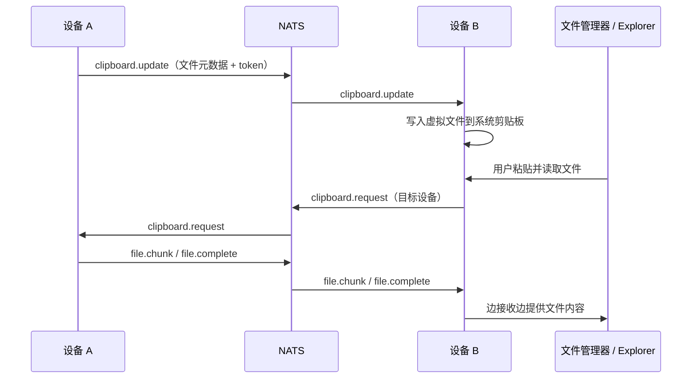

# clipboard-sync

> 面向局域网的低延迟跨平台剪贴板同步：Linux 和 Windows 间复制文本、图片与文件，文件元数据即时到达，内容在粘贴时高速按需传输。

`clipboard-sync` 是一个以本机剪贴板体验为中心的跨平台同步 Agent。两台设备加入同一个 `group_id` 后，复制文本、图片或文件，便可在另一台设备直接粘贴。在稳定的局域网中，元数据同步近乎无感；文件内容不会在复制时预先传完，也不会被广播给所有设备。

| Linux | Windows |
| --- | --- |
| X11 / Wayland 剪贴板 + FUSE 虚拟文件 | Explorer 原生虚拟文件剪贴板 |
| 文件管理器直接 `Ctrl+V` | 资源管理器直接 `Ctrl+V` |

<p align="center">
  
</p>
<p align="center">
  
</p>

## 为什么使用它

- **保留原生粘贴体验**：无需先下载文件或打开专用客户端，在系统文件管理器中直接粘贴。
- **为低延迟而设计**：复制时立即发布轻量元数据，避免大文件阻塞剪贴板同步；真正的数据只在用户粘贴时发送。
- **按需传输**：复制阶段只传文件名、大小、校验和与访问 token；只有目标端读取文件时才传输数据。
- **大文件同样流畅**：内容按块流式发送，目标端边接收边写入临时文件，不会一次性载入内存。
- **局域网消息总线**：控制消息、图片数据和文件分块均经过 NATS，不依赖 HTTP、SSH 或共享目录。
- **多设备隔离**：`group_id` 限定可互相同步的设备，`device_id` 防止本机事件回环。

## 功能

- 实时同步文本剪贴板
- 同步图片剪贴板
- 同步单个文件、多个文件和文件夹的元数据
- Linux <-> Windows、Linux <-> Linux、Windows <-> Windows 文件粘贴
- 文件内容按目标设备单播，支持重复分块忽略、缺块检测与 SHA256 校验
- 复制后隔几分钟再粘贴也能完成：当前剪贴板内容对应的 token 持续有效
- 分块丢失自动重新拉取，失败立刻回执，不再让文件管理器空等超时
- 剪贴板内容默认不进入后台剪贴板管理器与云剪贴板历史（Windows）
- NATS 断连后自动持续重连
- Linux FUSE 挂载异常后自动尝试恢复
- Linux 剪贴板命令带硬超时，卡住的剪贴板属主不会让 Agent 静默停摆
- Windows 单实例保护，避免重复启动两个 Agent 抢剪贴板
- 默认仅输出错误日志，正常运行保持安静

## 快速开始

准备两台可访问同一 NATS 服务的设备。下面以 Linux 为例；Windows 的构建与运行命令见[平台安装](#平台安装)。

```bash
git clone https://github.com/chendx-github/clipboard-sync.git
cd clipboard-sync

# Linux: X11 选择 xclip，Wayland 选择 wl-clipboard
sudo apt-get update && sudo apt-get install -y xclip fuse3 nats-server

go build -o agent ./cmd/agent
nats-server -c nats.conf   # 配置见「运行 NATS」：max_pending 必须放大
```

复制一份配置给每台设备，确保它们使用不同的 `device_id`、相同的 `group_id` 和可访问的 `nats_url`：

```yaml
# configs/linux.yaml
device_id: "linux-a"
group_id: "team-a"
nats_url: "nats://192.168.1.100:4222"
chunk_size: 1048576
poll_interval_ms: 500
log_level: "error"
clipboard_file_format: "uri-list" # Dolphin 使用 uri-list；Nautilus/Files 使用 gnome
```

启动 Agent：

```bash
./agent run -config configs/linux.yaml
```

在另一台设备完成同样配置并启动 Agent 后，复制一段文本或一个文件，再在目标设备直接粘贴即可。

## 使用方式

### 文本和图片

1. 在设备 A 复制文本或图片。
2. 设备 B 自动接收并写入本机剪贴板。
3. 在任何支持的应用中粘贴。

### 文件和文件夹

1. 在设备 A 的文件管理器中复制文件、多个文件或文件夹。
2. 设备 B 接收元数据，并把可读取的虚拟文件写入本机剪贴板。
3. 在设备 B 的文件管理器或 Windows Explorer 中按 `Ctrl+V`。
4. 文件管理器请求内容后，设备 A 才开始通过 NATS 流式发送数据。

文件内容和 token 在同一份元数据里发布。token 的生效规则：

- **当前剪贴板内容**对应的 token 一直有效，因此复制后隔几分钟再粘贴不会失败。
- 一旦复制了新的文件内容，旧 token 进入保留窗口（`token_ttl` 秒），并在每次成功请求时自动续期。
- 如果源端确实已无法提供数据（旧 token 超出保留窗口，或源文件已被删除），目标端会立刻收到 `transfer.error` 并显示失败，而不是空等超时；重新复制一次即可。

传输过程中如果某个分块因网络或 NATS 拥塞丢失，接收端会自动重置会话并向源端重新拉取整份文件（默认重试 2 次）。

## 工作原理



### 平台实现

| 平台 | 接收远程文件时的实现 |
| --- | --- |
| Linux | 将远程文件映射到 FUSE 虚拟目录，并把虚拟路径写入 X11/Wayland 剪贴板。 |
| Windows | 使用 OLE 虚拟文件剪贴板对象，供 Windows Explorer 按需读取。 |

### Linux 文件管理器兼容性

Linux 桌面环境对文件剪贴板使用的 MIME 类型并不完全一致。`clipboard_file_format` 用于选择 Agent 写入远程文件虚拟路径时使用的格式；一次只会提供一种格式。

| 配置值 | 剪贴板 MIME | 载荷格式 | 适用文件管理器 |
| --- | --- | --- | --- |
| `uri-list`（默认） | `text/uri-list` | `file://` URI 列表 | Dolphin |
| `gnome` | `x-special/gnome-copied-files` | `copy` + `file://` URI 列表 | GNOME Files / Nautilus |

如果粘贴时出现“剪贴板内容的文件名”之类的提示，说明文件管理器把剪贴板载荷当作普通文本处理。将 `clipboard_file_format` 切换为与当前文件管理器对应的值，重启 Agent 后重新从另一台设备复制文件。

### NATS 主题

| 主题 | 用途 |
| --- | --- |
| `clipboard.update` | 广播文本、图片或文件元数据 |
| `clipboard.request` | 目标端请求文件内容 |
| `file.chunk` / `file.complete` | 单播文件数据与完成信号 |
| `image.chunk` / `image.complete` | 单播图片数据与完成信号 |
| `transfer.error` | 源端无法提供数据时（token 失效、源文件缺失、发送失败）回执给请求端 |

## 平台安装

### 通用要求

- Go `1.22+`
- NATS Server `2.9+`
- 两台设备网络互通，均可访问同一 NATS 地址
- 每台设备拥有独立 `device_id`

### Linux

Agent 必须以当前桌面用户身份运行。以 root 运行可能无法访问用户剪贴板，或导致 FUSE 权限错误。

Debian / Ubuntu：

```bash
# X11
sudo apt-get update && sudo apt-get install -y xclip fuse3

# Wayland
sudo apt-get update && sudo apt-get install -y wl-clipboard fuse3
```

### Windows

- Windows 10 或 Windows 11
- 在 Windows Explorer 中完成文件粘贴
- PowerShell 或 CMD 可运行 Agent

构建：

```powershell
go build -o agent.exe .\cmd\agent
```

运行：

```powershell
.\agent.exe run -config configs\config-windows.yaml
```

从 Linux 构建 Windows 二进制：

```bash
GOOS=windows GOARCH=amd64 go build -o agent.exe ./cmd/agent
```

## 配置

示例文件：[configs/config.yaml](configs/config.yaml) 和 [configs/config-windows.yaml](configs/config-windows.yaml)。不要将示例中的 `device_id` 和网络地址直接用于多台设备。

```yaml
device_id: "linux-a"                         # 每台设备唯一
group_id: "team-a"                           # 相同分组互相同步
nats_url: "nats://192.168.1.100:4222"        # 共享 NATS 服务
chunk_size: 1048576                          # 1 MiB；需不大于 NATS max_payload
token_ttl: 60                                 # 旧 token 的保留/续期窗口（秒）
poll_interval_ms: 500                         # 剪贴板轮询间隔（毫秒）
cache_dir: ""                                # 留空使用系统临时目录
download_dir: ""                             # spool 和落地目录，留空使用系统临时目录
mount_dir: ""                                # Linux FUSE 挂载目录，留空使用系统临时目录
log_level: "error"                           # debug | info | warn | error
clipboard_file_format: "uri-list"            # Linux: uri-list (Dolphin) | gnome (Nautilus/Files)
```

配置要点：

- `nats_url` 必须是所有设备可访问的地址；远程 NATS 不应填写 `localhost`。
- `chunk_size` 最低为 `65536`，默认 `1048576`（1 MiB）。分块越大单条消息越大，快速传大文件时容易把 NATS 的每客户端待发缓冲区灌满，所以不建议调到 8 MiB 以上；同时 NATS 的 `max_payload` 必须大于 `chunk_size` 加协议开销。
- `token_ttl` 不是“复制后必须在这个时间内粘贴”：当前剪贴板内容对应的 token 一直有效，该值只控制**被新内容替换后**旧 token 的保留时间，并在每次成功请求时续期。
- `cache_dir`、`download_dir` 和 `mount_dir` 在生产环境建议设置为稳定且可写的目录。
- `clipboard_file_format` 仅影响 Linux 接收远程文件后的文件剪贴板写入。默认 `uri-list` 使用标准 `text/uri-list`，适用于 Dolphin。
- GNOME Files/Nautilus 使用 `gnome`，其载荷为 `x-special/gnome-copied-files` 和 `copy` 操作标记。切换该配置后必须重启 Agent，并重新复制远程文件。

## 运行 NATS

本机自测可以临时用默认参数启动：

```bash
nats-server -p 4222
```

正式使用请改用下面的配置文件（默认的 64 MiB 待发缓冲在快速传大文件时不够）。

局域网使用时，放开 NATS 端口并将配置中的 `nats_url` 改为实际监听地址。**服务端必须同时放大 `max_pending`**，否则接收端稍慢一点就会触发 `Slow Consumer Detected: MaxPending ... Exceeded`，表现为“复制一会儿就报错”：

```conf
listen: 0.0.0.0:4222
max_payload: 16777216
max_pending: 268435456   # 256 MiB；默认 64 MiB 在 1 MiB 分块快速传大文件时不够
```

修改后重启 `nats-server`（两端 Agent 会自动重连）。如果日志里仍然出现 slow consumer，可以继续调大 `max_pending`，或降低 `chunk_size`。

## 验证清单

建议按以下顺序验证部署：

1. 两端启动 Agent，确认没有 NATS 连接错误。
2. 复制一段文本，在另一端粘贴并核对内容。
3. 复制图片，在另一端粘贴并核对图像。
4. 复制一个小文件，在目标文件管理器中粘贴并核对大小与内容。
5. 复制多个文件和一个文件夹，确认目标端可正常粘贴。
6. 使用大文件验证磁盘空间、网络吞吐与内存占用（中途报错时先查 NATS 的慢消费者日志）。
7. 拔插网络或重启 NATS，确认两端日志出现 `nats reconnected` 后可继续同步。
8. 在 Windows 上再启动一个 Agent，确认被单实例保护拒绝。

## 常见问题

### Linux 提示找不到剪贴板命令

- X11 安装 `xclip`。
- Wayland 安装 `wl-clipboard`，并确认 `wl-copy` / `wl-paste` 在 `PATH` 中。

### Linux 无法粘贴远程文件

- 确认安装 `fuse3`，且 `mount_dir` 的父目录可写。
- 确认在文件管理器中粘贴，而不是终端或普通文本输入框。
- 确认 Agent 由当前桌面用户运行。
- Dolphin 使用 `clipboard_file_format: "uri-list"`；GNOME Files/Nautilus 使用 `clipboard_file_format: "gnome"`。修改配置后重启 Agent，并重新复制远程文件。

### 两台设备没有同步

- 检查两端 `device_id` 不同、`group_id` 相同。
- 检查 `nats_url` 相同且可从双方访问。
- 检查 NATS 端口和防火墙规则。
- 将 `log_level` 临时设置为 `info` 或 `debug`，查看连接与剪贴板事件。

### 文件复制慢或失败

- 检查 NATS 服务端日志是否出现 `Slow Consumer Detected: MaxPending ... Exceeded`。出现即说明接收端消费不及，需调大 `max_pending`（见[运行 NATS](#运行-nats)）或降低 `chunk_size`。
- 目标端日志中出现 `restarting stalled transfer` 属于丢块自动重试，一般会自行完成；若持续重试失败，再检查网络与 NATS。
- 确认 NATS 的 `max_payload` 大于 `chunk_size` 加上协议开销。
- 使用低延迟网络部署 NATS，避免源文件位于高延迟网络盘。
- 检查目标设备磁盘空间；接收端会先写入本地 spool 文件。
- 源文件已被删除或移动时，目标端会立即收到“请重新复制”的错误，重新复制即可。

### 粘贴报错“文件传输 token 已失效，请重新复制”

说明源端已不再持有这份内容（旧 token 超出保留窗口或源文件已删除）。重新在源设备复一次文件再粘贴即可；当前复制内容对应的 token 本身不会因时间流逝失效。

### Windows 上粘贴时资源管理器像卡住了（光标不变、无法框选）

旧版本会把整个文件以 `HGlobal` 形式同步交给 Explorer 的 UI 线程。现在只提供 `IStream` 并单次限幅（1 MiB），Explorer 会流式读取并保持可操作；若仍出现长时间无响应，请查看日志中的 `windows file stream read failed`。

### 远程内容出现在剪贴板管理器/云剪贴板历史里

Windows 侧写入时会声明 `ExcludeClipboardContentFromMonitorProcessing`、`CanIncludeInClipboardHistory=0`、`CanUploadToCloudClipboard=0`，主流剪贴板管理器（如 CopyQ）与 Windows 剪贴板历史会跳过这类内容。如果仍被记录，请在该工具的排除/忽略规则里跳过对应格式。

### Linux 复制很久后 Agent 不再同步

旧版本中，一个不响应 TARGETS 请求的剪贴板属主会让 `xclip` 永久阻塞，Agent 静默停止发布。现在所有 `xclip` / `wl-paste` 调用都有硬超时（查询 3s、负载 20s、写入 15s），超时会被杀进程并在 stderr 限流输出 `clipboard read skipped: ...`。（`pm2 logs` 或 journalctl 可见）

## 运维建议

- 使用 systemd、pm2 或 Windows 计划任务在用户登录后启动 Agent。
- 为每个设备配置固定的 `device_id`，并为不同团队或环境分配不同 `group_id`。
- 生产环境将 NATS 部署在可信网络中，并按实际需要配置网络访问控制。
- 默认日志级别为 `error`；排障结束后恢复该级别，避免正常传输刷屏。
- **Windows 只能存在一个实例**：新版用命名互斥量做单实例保护，重复双击会直接退出并提示 `another clipboard-sync agent is already running`。
- **Windows 必须在交互式登录会话里启动**：剪贴板属于用户会话，通过 SSH（session 0）或 Windows 服务方式启动的 Agent 拿不到剪贴板；可用 `schtasks /run` 配合任务计划（Interactive 登录类型）拉起。
- 建议把 Windows 端 stdout 重定向到日志文件，否则双击启动时没有日志可查。

Linux systemd 的服务命令示例：

```bash
/path/to/agent run -config /path/to/config.yaml
```

pm2 管理示例：

```bash
pm2 start /path/to/agent --name clipboard-sync -- run -config /path/to/config.yaml
pm2 restart clipboard-sync
```

Windows 计划任务（交互会话、隐藏窗口、日志重定向）示例：

```powershell
# start-agent.vbs 中：隐藏窗口启动，输出追加到 agent.log
# cmd /c ""E:\path\agent.exe" -config "E:\path\config-windows.yaml" >> "E:\path\agent.log" 2>&1"
schtasks /run /tn clipboard-sync-agent
```

## 开发

```bash
# 格式化
gofmt -l .

# 整理依赖
go mod tidy

# 单测
go test ./...

# 构建 Linux Agent
go build -o agent ./cmd/agent

# 交叉构建 Windows Agent
GOOS=windows GOARCH=amd64 go build -o agent.exe ./cmd/agent
```

新增或修改传输、token、剪贴板行为时，请同步补充 `chunk/`、`transfer/`、`protocol/`、`clipboard/` 下的单测（`go test ./...` 必须全绿）。

## 当前限制

- Linux -> Windows 的大文件吞吐可能低于 Windows -> Linux，主要受 Windows Explorer 的 OLE 虚拟文件读取方式影响。
- 为保证文件管理器不被阻塞，`IStream` 单次读取上限为 1 MiB；超大文件会有多次往返，但不会再卡住 Explorer。
- 传输依赖 NATS 的每客户端缓冲：`max_pending` 太小会在快速传大文件时丢块（现已有自动重试，但仍建议调大）。
- 剪贴板内容会进入目标端剪贴板，但（Windows 上）会标记为排除监视；Linux 侧的剪贴板管理器没有对应协议，如需彻底屏蔽请在其排除规则里处理。
- Linux 文件剪贴板只能同时发布一种 MIME 格式；同一台设备需要在 Dolphin 与 GNOME Files/Nautilus 之间切换使用时，必须修改 `clipboard_file_format` 并重启 Agent。

## 贡献

欢迎提交 Issue 和 Pull Request。修复跨平台兼容性时，请说明操作系统版本、桌面环境、NATS 版本、复现步骤与日志级别，便于定位剪贴板和文件管理器差异。
